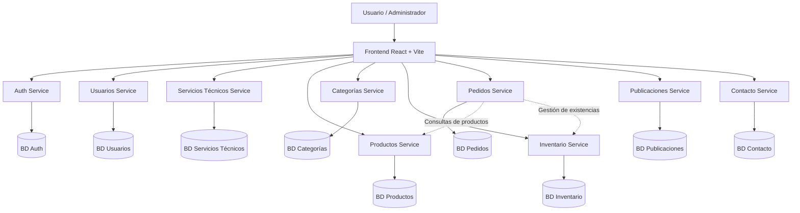
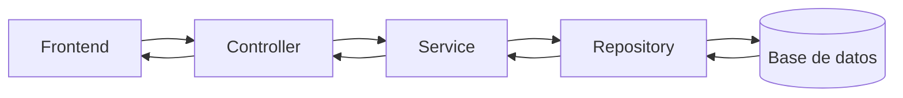
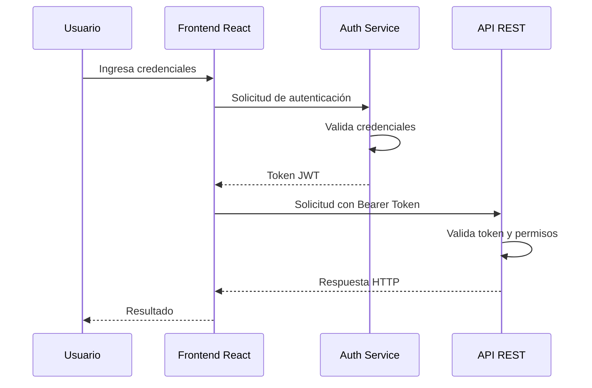
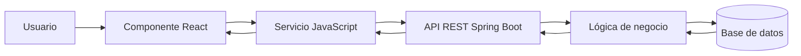
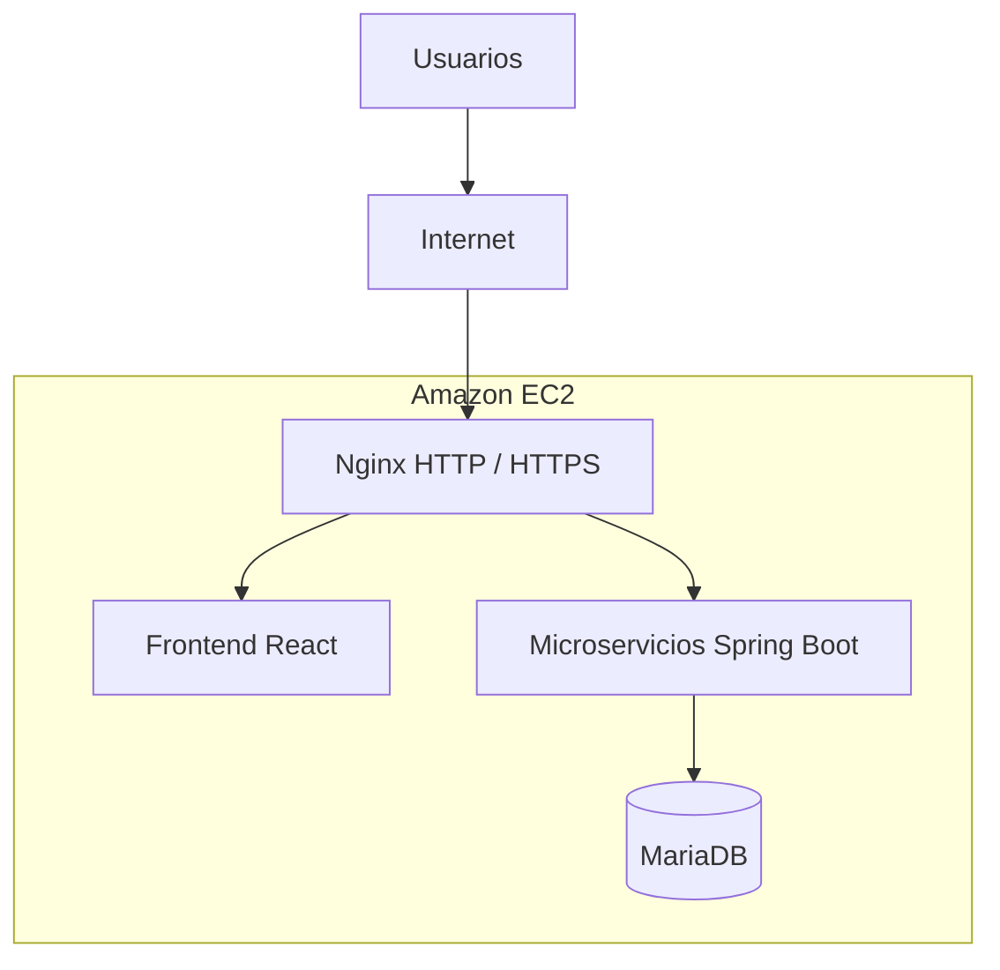

# Sonido Vivo | Backend

Plataforma de comercio electrónico especializada en instrumentos musicales, accesorios y servicios técnicos.

**Desarrollo Fullstack II (DSY1104) | Ingeniería en Informática | Duoc UC**


---

## 1. Descripción del proyecto

Sonido Vivo es una plataforma de comercio electrónico orientada a la comercialización de instrumentos musicales y accesorios, complementada con servicios técnicos especializados, publicaciones informativas y canales de comunicación con clientes.

Este repositorio concentra los servicios backend de la plataforma, diseñados mediante una arquitectura de microservicios independientes desarrollados con Spring Boot.

La solución está estructurada en API REST con persistencia de datos, lógica de negocio, validaciones, autenticación mediante JSON Web Tokens (JWT), autorización basada en roles y documentación de endpoints mediante Swagger.

El frontend se desarrolló de forma independiente con React y Vite, para comunicarse con los servicios backend mediante solicitudes HTTP e intercambio de información en formato JSON.

El desarrollo del backend reúne los nueve microservicios definidos por el equipo. Se completó y verificó localmente la integración básica entre Productos, Inventario y Pedidos, incluida la actualización de existencias al crear o cancelar compras. Las verificaciones finales de integración general y despliegue se gestionan por separado.

---

## 2. Objetivos del proyecto

### Objetivo general

Desarrollar una plataforma web Full Stack que permita gestionar las operaciones comerciales y administrativas de Sonido Vivo mediante una arquitectura de microservicios modular, segura, escalable y mantenible.

### Objetivos específicos

- Implementar servicios backend independientes utilizando Spring Boot.
- Diseñar modelos de datos relacionados con los requerimientos funcionales del negocio.
- Gestionar la persistencia de información mediante bases de datos relacionales.
- Implementar operaciones CRUD mediante API REST.
- Documentar los endpoints utilizando Swagger y OpenAPI.
- Integrar los servicios backend con el frontend desarrollado en React.
- Implementar autenticación mediante JWT.
- Establecer mecanismos de autorización basados en roles y permisos.
- Gestionar la persistencia de sesiones de usuario.
- Validar la información ingresada mediante formularios y solicitudes HTTP.
- Aplicar buenas prácticas de desarrollo, seguridad y control de versiones.
- Preparar la aplicación para su despliegue en infraestructura cloud.

---

## 3. Arquitectura del sistema

Sonido Vivo utiliza una arquitectura compuesta por nueve microservicios Spring Boot, organizados dentro de un repositorio backend común.

Cada microservicio cuenta con su propio proyecto Maven, configuración, responsabilidades funcionales y esquema de base de datos.

### Diagrama general de arquitectura



El diagrama resume la arquitectura del backend. La comunicación entre Pedidos, Productos e Inventario se verificó mediante pruebas locales con Swagger; otras integraciones se documentan según su evidencia disponible.

### Principios de arquitectura

- Separación de responsabilidades.
- Independencia funcional de los microservicios.
- Comunicación mediante API REST.
- Persistencia independiente por dominio.
- Modularidad y mantenibilidad.
- Validación de reglas de negocio.
- Centralización del manejo de excepciones.
- Seguridad mediante autenticación y autorización.
- Externalización de configuraciones sensibles.
- Preparación para despliegue independiente.

---

## 4. Microservicios

El backend está organizado en los siguientes nueve microservicios:

| Microservicio | Puerto | Base de datos | Responsabilidad |
|---|---:|---|---|
| Auth Service | 8081 | sonidovivo_auth | Autenticación, generación y renovación de JWT. |
| Usuarios Service | 8082 | sonidovivo_usuarios | Registro, perfiles y administración de usuarios. |
| Servicios Técnicos Service | 8083 | sonidovivo_servicios_tecnicos | Gestión de solicitudes de servicios técnicos. |
| Productos Service | 8084 | sonidovivo_productos | Administración del catálogo de productos. |
| Categorías Service | 8085 | sonidovivo_categorias | Organización y clasificación de productos. |
| Inventario Service | 8086 | sonidovivo_inventario | Control de stock y disponibilidad. |
| Pedidos Service | 8087 | sonidovivo_pedidos | Gestión de pedidos y detalles de compra. |
| Publicaciones Service | 8088 | sonidovivo_publicaciones | Gestión de contenido informativo y publicaciones. |
| Contacto Service | 8089 | sonidovivo_contacto | Recepción y administración de mensajes de contacto. |

### Puertos complementarios

| Componente | Puerto |
|---|---:|
| Frontend React + Vite | 5173 |
| MySQL / MariaDB | 3306 |
| Servidor HTTP Nginx | 80 |
| Servidor HTTPS Nginx | 443 |

Los puertos y nombres aquí indicados corresponden a la organización de servicios definida para el proyecto.

---

## 5. Tecnologías utilizadas

### Backend

| Tecnología | Propósito |
|---|---|
| Java | Lenguaje principal de programación. |
| Spring Boot | Desarrollo y configuración de microservicios. |
| Spring Web MVC | Implementación de API REST. |
| Spring Data JPA | Acceso y persistencia de datos. |
| Hibernate | Mapeo objeto-relacional (ORM). |
| Spring Security | Seguridad y control de acceso. |
| JWT | Autenticación basada en tokens. |
| JJWT | Generación y validación de tokens JWT. |
| Jakarta Validation | Validación de datos de entrada. |
| Lombok | Reducción de código repetitivo. |
| Maven | Gestión de dependencias y compilación. |
| Swagger / OpenAPI | Documentación de API REST. |

### Frontend

- React.
- Vite.
- JavaScript.
- HTML5.
- CSS3.
- Bootstrap.
- React Router.
- Fetch API.

### Base de datos

- MySQL.
- MariaDB.
- MySQL Connector/J.
- phpMyAdmin.
- XAMPP para el entorno de desarrollo local.

### Herramientas de desarrollo

- Visual Studio Code.
- Spring Initializr.
- Postman.
- Swagger UI.
- Git.
- GitHub.
- Maven Wrapper.

### Infraestructura de despliegue

- Amazon Web Services (AWS).
- Amazon EC2.
- Linux Ubuntu.
- Nginx.
- MariaDB.
- systemd.

Las versiones específicas de las dependencias se encuentran definidas en el archivo `pom.xml` de cada microservicio.

---

## 6. Estructura del repositorio

La estructura del repositorio backend es la siguiente:

```text
sonido-vivo-backend/
│
├── authservice/
├── usuariosservice/
├── serviciostecnicosservice/
├── productosservice/
├── categoriaservice/
├── inventarioservice/
├── pedidosservice/
├── publicacionesservice/
├── contactoservice/
│
└── README.md
```

Cada microservicio constituye un proyecto Spring Boot independiente.

### Estructura interna de referencia

```text
contactoservice/
│
├── .mvn/
│   └── wrapper/
│
├── src/
│   ├── main/
│   │   ├── java/
│   │   │   └── cl/
│   │   │       └── sonidovivo/
│   │   │           └── contactoservice/
│   │   │               ├── config/
│   │   │               ├── controller/
│   │   │               ├── exception/
│   │   │               ├── model/
│   │   │               ├── repository/
│   │   │               ├── service/
│   │   │               └── ContactoserviceApplication.java
│   │   │
│   │   └── resources/
│   │       └── application.properties
│   │
│   └── test/
│
├── .gitattributes
├── .gitignore
├── mvnw
├── mvnw.cmd
└── pom.xml
```

### Arquitectura por capas

| Capa | Responsabilidad |
|---|---|
| Model | Definición de entidades y atributos del dominio. |
| Repository | Acceso y persistencia de información. |
| Service | Implementación de lógica y reglas de negocio. |
| Client | Comunicación HTTP con las API de otros microservicios. |
| Controller | Exposición de endpoints REST. |
| Exception | Gestión centralizada de errores y excepciones. |
| Config | Configuración de seguridad, JWT, CORS y Swagger. |
| DTO | Transferencia controlada de información cuando corresponda. |

### Flujo de procesamiento



---

## 7. API REST y funcionalidades

Los microservicios utilizan el protocolo HTTP y el formato JSON para intercambiar información.

### Métodos HTTP

| Método | Operación |
|---|---|
| GET | Consultar información. |
| POST | Crear nuevos registros. |
| PUT | Actualizar registros existentes. |
| DELETE | Eliminar registros cuando las reglas del negocio lo permitan. |

### Recursos principales

Las siguientes rutas identifican los recursos REST principales de los microservicios. Los métodos disponibles y sus permisos deben consultarse en Swagger de cada servicio.

| Microservicio | Ruta base |
|---|---|
| Auth | `/api/v1/auth` |
| Usuarios | `/api/v1/usuarios` |
| Servicios Técnicos | `/api/v1/servicios-tecnicos` |
| Productos | `/api/productos` |
| Categorías | `/api/categorias` |
| Inventario | `/api/inventario` |
| Pedidos | `/api/pedidos` |
| Publicaciones | `/api/publicaciones` |
| Contacto | `/api/contactos` |

### 7.1. Auth Service

Responsable de la autenticación y seguridad de los usuarios.

#### Endpoints implementados

| Método | Endpoint | Acceso | Respuesta |
|---|---|---|---|
| POST | `/api/v1/auth/login` | Público | 200 OK |
| POST | `/api/v1/auth/registro` | Público | 201 Created |
| POST | `/api/v1/auth/refresh` | Público, con token vigente en el cuerpo | 200 OK |
| GET | `/api/v1/auth/usuarios` | ADMIN | 200 OK |
| GET | `/api/v1/auth/usuarios/{id}` | ADMIN | 200 OK |
| POST | `/api/v1/auth/usuarios` | ADMIN | 201 Created |
| PUT | `/api/v1/auth/usuarios/{id}` | ADMIN | 200 OK |
| DELETE | `/api/v1/auth/usuarios/{id}` | ADMIN (desactiva la cuenta) | 204 No Content |

### 7.2. Usuarios Service

Responsable de la administración de usuarios de la plataforma.

#### Endpoints implementados

| Método | Endpoint | Acceso | Respuesta |
|---|---|---|---|
| GET | `/api/v1/usuarios/correo/{correo}` | Con token | 200 OK |
| POST | `/api/v1/usuarios` | Con token | 201 Created |
| PUT | `/api/v1/usuarios/{id}` | Con token | 200 OK |
| GET | `/api/v1/usuarios` | ADMIN | 200 OK |
| GET | `/api/v1/usuarios/{id}` | ADMIN | 200 OK |
| DELETE | `/api/v1/usuarios/{id}` | ADMIN | 204 No Content |

### 7.3. Servicios Técnicos Service

Responsable de gestionar las solicitudes de asistencia técnica relacionadas con instrumentos musicales.

#### Endpoints implementados

| Método | Endpoint | Acceso | Respuesta |
|---|---|---|---|
| POST | `/api/v1/servicios-tecnicos` | Público | 201 Created |
| GET | `/api/v1/servicios-tecnicos/correo/{correo}` | Con token | 200 OK |
| GET | `/api/v1/servicios-tecnicos` | ADMIN | 200 OK |
| GET | `/api/v1/servicios-tecnicos/{id}` | ADMIN | 200 OK |
| PUT | `/api/v1/servicios-tecnicos/{id}` | ADMIN | 200 OK |
| PUT | `/api/v1/servicios-tecnicos/{id}/estado` | ADMIN | 200 OK |
| DELETE | `/api/v1/servicios-tecnicos/{id}` | ADMIN | 204 No Content |

### 7.4. Productos Service

Responsable de administrar el catálogo comercial de Sonido Vivo.

Funciones del servicio:

- Registro de productos.
- Consulta del catálogo.
- Actualización de productos.
- Administración de precios y características.
- Asociación con categorías.
- Gestión de disponibilidad comercial.

### 7.5. Categorías Service

Responsable de organizar y clasificar los productos.

Funciones del servicio:

- Creación de categorías.
- Consulta de categorías.
- Actualización de categorías.
- Eliminación controlada de categorías.
- Clasificación del catálogo comercial.

### 7.6. Inventario Service

Responsable del control de existencias.

Funciones del servicio:

- Registro de existencias.
- Consulta de stock.
- Actualización de cantidades.
- Validación de disponibilidad.
- Gestión de movimientos de inventario.
- Integración con Productos y Pedidos.

### 7.7. Pedidos Service

Responsable de gestionar las operaciones de compra de los clientes.

Funciones del servicio:

- Creación de pedidos.
- Registro de detalles del pedido.
- Consulta del historial de compras.
- Cálculo de totales.
- Validación de productos y disponibilidad.
- Gestión de estados del pedido.
- Asociación de pedidos con usuarios autenticados.
- Administración de pedidos.

Reglas de negocio:

- Validación de cantidades solicitadas.
- Verificación de disponibilidad de productos.
- Obtención de precios desde fuentes confiables del backend.
- Cálculo de subtotales y montos totales.
- Protección de la información de compra.
- Validación de permisos para consultar pedidos.

### 7.8. Publicaciones Service

Responsable de administrar el contenido informativo de Sonido Vivo.

Funciones del servicio:

- Creación de publicaciones.
- Consulta de publicaciones.
- Actualización de contenido.
- Eliminación de publicaciones.
- Gestión de contenido visible para los clientes.
- Administración restringida mediante roles.

### 7.9. Contacto Service

Responsable de recibir y administrar los mensajes enviados por los usuarios mediante el formulario de contacto.

#### Endpoints implementados

| Método | Endpoint | Acceso | Respuesta |
|---|---|---|---|
| GET | `/api/contactos` | ADMIN | 200 OK |
| GET | `/api/contactos/{id}` | ADMIN | 200 OK |
| POST | `/api/contactos` | Público | 201 Created |
| PUT | `/api/contactos/{id}` | ADMIN | 200 OK |
| DELETE | `/api/contactos/{id}` | ADMIN | 204 No Content |

#### Modelo de datos

| Atributo | Tipo | Restricción |
|---|---|---|
| id | Long | Identificador autogenerado. |
| nombre | String | Obligatorio, entre 3 y 100 caracteres. |
| correo | String | Obligatorio, correo válido, máximo 254 caracteres. |
| asunto | String | Obligatorio, entre 4 y 150 caracteres. |
| mensaje | String | Obligatorio, entre 10 y 2000 caracteres. |
| fechaCreacion | LocalDateTime | Generada automáticamente por el backend. |

#### Ejemplo de solicitud POST

```json
{
  "nombre": "Cliente de ejemplo",
  "correo": "cliente@example.com",
  "asunto": "Consulta sobre guitarra",
  "mensaje": "Me gustaría conocer la disponibilidad de guitarras eléctricas."
}
```

#### Reglas de negocio

- Todos los campos del formulario son obligatorios.
- El correo electrónico debe tener un formato válido.
- El identificador se genera automáticamente.
- La fecha de creación es asignada por el backend.
- La actualización conserva la fecha de creación original.
- Cualquier visitante puede enviar un mensaje de contacto.
- Solo los administradores pueden consultar, actualizar y eliminar mensajes.
- Los datos inválidos no deben almacenarse.
- Las solicitudes de registros inexistentes generan una respuesta HTTP 404.

---

## 8. Persistencia y bases de datos

La plataforma utiliza bases de datos relacionales para garantizar la persistencia y organización de la información.

Cada microservicio contempla un esquema independiente, permitiendo separar los datos según su dominio funcional.

La persistencia se implementa mediante Spring Data JPA e Hibernate.

### Principios de persistencia

- Independencia de esquemas.
- Integridad de datos.
- Uso de identificadores únicos.
- Normalización de modelos de datos.
- Validación de restricciones.
- Reducción de redundancia.
- Persistencia de registros después de reiniciar los servicios.
- Acceso a datos mediante repositorios.

Los microservicios no deben consultar directamente las tablas pertenecientes a otros servicios. Cuando exista una dependencia funcional, la comunicación debe efectuarse mediante contratos de integración.

---

## 9. Seguridad y autenticación

La arquitectura de seguridad contempla Spring Security y autenticación basada en JSON Web Tokens (JWT).

Los tokens permiten identificar al usuario autenticado y controlar el acceso a los recursos protegidos.

### Roles principales

| Rol | Descripción |
|---|---|
| ADMIN | Usuario con permisos administrativos. |
| USER | Cliente autenticado con permisos limitados. |
| Público | Visitante sin autenticación. |

### Flujo de autenticación



### Encabezado de autorización

```http
Authorization: Bearer <token>
```

### Mecanismos de seguridad

- Validación de la firma del token JWT.
- Verificación del emisor.
- Validación de la fecha de expiración.
- Identificación de roles.
- Restricción de endpoints protegidos.
- Configuración CORS.
- Gestión centralizada de errores.
- Autenticación sin estado mediante JWT.
- Externalización de credenciales y claves privadas.
- Protección de información sensible.
- Renovación segura de tokens como requisito de Auth.
- Uso de HTTPS en el entorno de producción.

Contacto Service cuenta con validación JWT y restricciones de acceso implementadas y probadas localmente.

La validación de JWT se ha utilizado en pruebas locales. La emisión, renovación y continuidad de sesión de Auth deben comprobarse en las pruebas integrales del sistema.

### Códigos de respuesta de seguridad

| Código HTTP | Significado |
|---|---|
| 400 Bad Request | Datos inválidos. |
| 401 Unauthorized | Autenticación inexistente o inválida. |
| 403 Forbidden | Usuario sin los permisos necesarios. |
| 404 Not Found | Recurso inexistente. |

---

## 10. Instalación y ejecución local

### Requisitos previos

- Java JDK compatible con el proyecto.
- MySQL o MariaDB.
- Git.
- Maven o Maven Wrapper.
- Node.js y npm para el frontend.
- Visual Studio Code u otro entorno de desarrollo.

### 10.1. Clonar el repositorio

```bash
git clone https://github.com/NoemiBello/sonido-vivo-backend.git
```

Acceder al directorio:

```bash
cd sonido-vivo-backend
```

### 10.2. Configuración de la base de datos

Cada microservicio requiere su propia configuración de conexión.

Ejemplo correspondiente a Contacto Service:

```sql
CREATE DATABASE IF NOT EXISTS sonidovivo_contacto
CHARACTER SET utf8mb4
COLLATE utf8mb4_unicode_ci;
```

Creación del usuario:

```sql
CREATE USER 'contacto_app'@'localhost'
IDENTIFIED BY 'REEMPLAZAR_CON_CLAVE_SEGURA';
```

Asignación de permisos para desarrollo:

```sql
GRANT ALL PRIVILEGES
ON `sonidovivo_contacto`.*
TO 'contacto_app'@'localhost';

FLUSH PRIVILEGES;
```

Si el usuario ya existe, no es necesario crearlo nuevamente.

### 10.3. Variables de entorno

Las configuraciones sensibles se mantienen fuera del código fuente mediante variables de entorno.

| Variable | Descripción |
|---|---|
| DB_URL | URL de conexión a la base de datos. |
| DB_USER | Usuario de base de datos. |
| DB_PASSWORD | Contraseña de base de datos. |
| JWT_SECRET | Clave privada utilizada para la firma y validación JWT. |
| JWT_ISSUER | Emisor autorizado del token. |

Ejemplo de configuración en Windows CMD:

```cmd
cd contactoservice

set "DB_URL=jdbc:mysql://localhost:3306/sonidovivo_contacto?createDatabaseIfNotExist=true"

set "DB_USER=contacto_app"

set "DB_PASSWORD=REEMPLAZAR_CON_CLAVE_PRIVADA"

set "JWT_SECRET=REEMPLAZAR_CON_SECRETO_BASE64_VALIDO"

set "JWT_ISSUER=sonidovivo-auth"
```

Los valores anteriores son referencias de configuración y deben sustituirse por credenciales privadas válidas.

La clave JWT debe mantenerse de forma segura y ser compatible con la configuración de Auth Service.

### 10.4. Ejecutar un microservicio

Desde la carpeta correspondiente al microservicio:

Windows:

```cmd
mvnw.cmd spring-boot:run
```

Linux o macOS:

```bash
./mvnw spring-boot:run
```

Cada servicio debe ejecutarse utilizando su puerto asignado y sus respectivas variables de entorno.

### 10.5. Compilación del proyecto

Windows:

```cmd
mvnw.cmd clean compile
```

Linux o macOS:

```bash
./mvnw clean compile
```

### 10.6. Empaquetado

```cmd
mvnw.cmd clean package
```

El archivo JAR se generará dentro del directorio:

```text
target/
```

La ejecución del empaquetado requiere que las dependencias y configuraciones necesarias para las pruebas estén disponibles.

---

## 11. Documentación Swagger y OpenAPI

Los servicios REST contemplan documentación interactiva mediante Swagger UI y OpenAPI.

Swagger permite:

- Visualizar los endpoints disponibles.
- Consultar métodos HTTP.
- Revisar parámetros.
- Consultar modelos de datos.
- Ejecutar solicitudes.
- Revisar respuestas HTTP.
- Realizar pruebas de autenticación.

### Acceso a Swagger

| Microservicio | URL prevista |
|---|---|
| Auth | http://localhost:8081/swagger-ui.html |
| Usuarios | http://localhost:8082/swagger-ui.html |
| Servicios Técnicos | http://localhost:8083/swagger-ui.html |
| Productos | http://localhost:8084/swagger-ui.html |
| Categorías | http://localhost:8085/swagger-ui.html |
| Inventario | http://localhost:8086/swagger-ui.html |
| Pedidos | http://localhost:8087/swagger-ui.html |
| Publicaciones | http://localhost:8088/swagger-ui.html |
| Contacto | http://localhost:8089/swagger-ui.html |

Las URL estarán disponibles una vez implementado y ejecutado cada microservicio con su configuración correspondiente.

### Especificación OpenAPI de Contacto

```text
http://localhost:8089/v3/api-docs
```

Para realizar solicitudes protegidas se debe utilizar la opción **Authorize** de Swagger con un token JWT válido.

---

## 12. Pruebas y validaciones

El proceso de verificación contempla pruebas funcionales, validación de datos, persistencia, seguridad e integración entre frontend y backend.

### Herramientas de prueba

- Swagger UI.
- Postman.
- Navegador web.
- Herramientas de desarrollo del navegador.
- phpMyAdmin.
- Maven y Spring Boot Test.

### Códigos de respuesta HTTP

| Código | Estado | Descripción |
|---|---|---|
| 200 | OK | Operación realizada correctamente. |
| 201 | Created | Registro creado correctamente. |
| 204 | No Content | Operación exitosa sin contenido de respuesta. |
| 400 | Bad Request | Solicitud con información inválida. |
| 401 | Unauthorized | Autenticación requerida o inválida. |
| 403 | Forbidden | Acceso denegado por falta de permisos. |
| 404 | Not Found | Recurso no encontrado. |
| 500 | Internal Server Error | Error interno del servidor. |

### Matriz de pruebas ejecutadas: Contacto Service

| Prueba | Código esperado | Swagger | Postman |
|---|---:|---|---|
| Listar contactos sin token | 401 | Aprobado | Aprobado |
| Listar contactos como ADMIN | 200 | Aprobado | Aprobado |
| Listar contactos como USER | 403 | Aprobado | Aprobado |
| Crear contacto válido | 201 | Aprobado | Aprobado |
| Crear contacto inválido | 400 | Aprobado | Aprobado |
| Consultar contacto por ID | 200 | Aprobado | Aprobado |
| Consultar contacto inexistente | 404 | Aprobado | Aprobado |
| Actualizar contacto | 200 | Aprobado | Aprobado |
| Eliminar contacto | 204 | Aprobado | Aprobado |

También se verificó la persistencia de información después de reiniciar el backend.

Las pruebas anteriores corresponden a verificaciones manuales ejecutadas sobre Contacto Service.

### Integración verificada: Pedidos, Productos e Inventario

Se comprobaron localmente las siguientes operaciones mediante Swagger:

- Creación de categoría y producto para pruebas de compra.
- Registro y consulta de existencias de inventario.
- Creación de un pedido con respuesta HTTP **201**, total calculado y estado `PENDIENTE`.
- Descuento automático de **1 unidad** de stock al registrar el pedido (de 9 a 8).
- Cancelación del pedido mediante `PATCH`, con reposición automática de **1 unidad** (de 8 a 9).
- Rechazo por stock insuficiente con respuesta HTTP **400** y mensaje explicativo.

Las pruebas anteriores acreditan el flujo funcional básico, no la consistencia distribuida ante fallos, concurrencia o pedidos con múltiples productos.

### Pruebas de integración y validaciones finales

- Comunicación entre React y las API REST.
- Autenticación de usuarios.
- Validación de tokens entre microservicios.
- Renovación y expiración de tokens.
- Persistencia de sesión después de recargar la página.
- Restricciones de acceso según roles.
- Validaciones de formularios.
- Gestión de errores.
- Consistencia entre productos, inventario y pedidos.
- Funcionamiento de la aplicación desplegada.

Las evidencias de pruebas locales y de integración se registran en la documentación técnica correspondiente.

---

## 13. Integración con el frontend

El frontend de Sonido Vivo está desarrollado mediante React y Vite.

La comunicación con los microservicios se realiza mediante solicitudes HTTP, utilizando una capa de servicios JavaScript para centralizar las operaciones de acceso a las API.

### Responsabilidades del frontend

- Presentación de información.
- Gestión de formularios.
- Validación de datos de entrada.
- Consumo de servicios REST.
- Gestión del estado de autenticación.
- Persistencia de sesión.
- Protección de rutas.
- Restricción de funcionalidades según roles.
- Gestión de respuestas y errores.
- Administración de estados de carga.

### Flujo de integración



### Gestión de sesiones

La integración contempla:

- Conservación del estado de autenticación.
- Restauración de sesión después de recargar la página.
- Validación de expiración del token.
- Cierre de sesión.
- Redirección de usuarios no autenticados.
- Protección de rutas administrativas.
- Restricción de funcionalidades según permisos.

Las restricciones en la interfaz complementan, pero no reemplazan, los controles de autorización implementados en el backend.

### Variables de entorno del frontend

La configuración de URL de las API se realiza mediante variables de entorno de Vite.

Ejemplo:

```env
VITE_CONTACTO_API_URL=http://localhost:8089/api/contactos
```

Las variables `VITE_*` son accesibles desde el navegador y no deben contener contraseñas ni claves privadas.

---

## 14. Despliegue en AWS

La arquitectura contempla el despliegue de Sonido Vivo mediante servicios de Amazon Web Services (AWS).

### Infraestructura de despliegue

- Amazon EC2.
- Sistema operativo Ubuntu.
- Java Runtime Environment.
- MariaDB.
- Nginx como servidor web y proxy inverso.
- systemd para administrar los procesos backend.
- Configuración de seguridad mediante grupos de seguridad.

### Arquitectura propuesta para despliegue



### Consideraciones de producción

- Externalización de credenciales.
- Configuración de variables de entorno.
- Protección de los puertos internos.
- Comunicación segura mediante HTTPS.
- Gestión de procesos independientes.
- Configuración de Nginx como proxy inverso.
- Validación de disponibilidad de los servicios.
- Dimensionamiento de recursos de memoria y CPU.
- Separación de configuraciones de desarrollo y producción.

La puesta en producción requiere verificar configuración, disponibilidad, conectividad y capacidad de la infraestructura.

---

## 15. Control de versiones

El proyecto utiliza Git y GitHub para administrar el código fuente y facilitar el desarrollo colaborativo.

### Organización de ramas

- `main`: rama principal del proyecto.
- Ramas individuales: desarrollo de funcionalidades y microservicios.

### Buenas prácticas

- Realizar commits descriptivos.
- Mantener una estructura organizada.
- Evitar la publicación de contraseñas.
- No incluir claves privadas ni tokens JWT.
- Excluir archivos compilados.
- Utilizar archivos `.gitignore`.
- Verificar el funcionamiento antes de integrar cambios.
- Mantener actualizada la documentación técnica.

### Repositorio backend

https://github.com/NoemiBello/sonido-vivo-backend

---

## 16. Equipo de desarrollo

Proyecto desarrollado colaborativamente por estudiantes de Ingeniería en Informática de Duoc UC.

| Integrante | Microservicios asignados |
|---|---|
| Noemí Bello | Pedidos, Publicaciones y Contacto. |
| Jeanpiere | Productos, Categorías e Inventario. |
| Manuel | Auth, Usuarios y Servicios Técnicos. |

### Responsabilidades compartidas

- Diseño de arquitectura.
- Integración frontend y backend.
- Coordinación de contratos API.
- Gestión de seguridad.
- Documentación técnica.
- Pruebas funcionales y de integración.
- Despliegue de la aplicación.
- Control de versiones.
- Presentación del proyecto.

---

## 17. Documentación y evaluación académica

El desarrollo del proyecto considera los requerimientos establecidos para la Evaluación Parcial N.º 3 de la asignatura Desarrollo Fullstack II.

### Criterios de desarrollo

| Criterio | Implementación y evidencia |
|---|---|
| Backend y base de datos | Modelos de datos, entidades JPA, repositorios y persistencia. |
| Lógica de negocio | Servicios, validaciones y restricciones funcionales. |
| API REST | Controladores y operaciones CRUD. |
| Documentación de API | Swagger y OpenAPI. |
| Integración frontend/backend | Comunicación mediante servicios REST y JSON. |
| Seguridad | Autenticación mediante JWT y autorización por roles. |
| Gestión de sesiones | Conservación del estado de autenticación. |
| Restricciones de acceso | Protección de rutas, interfaces y operaciones. |
| Pruebas | Validación funcional, seguridad e integración. |
| Control de versiones | Repositorios GitHub y desarrollo colaborativo. |

### Documentación complementaria

- Especificación de Requisitos de Software (ERS).
- Documento de API REST e integración.
- Documentación de endpoints.
- Manual de usuario.
- Evidencias de pruebas.
- Repositorio frontend.
- Repositorio backend.
- Archivos comprimidos de los proyectos.

Este README constituye la documentación técnica general del repositorio backend y complementa los documentos específicos de la evaluación.

---

## Estado del proyecto

El equipo completó el desarrollo de la estructura backend de Sonido Vivo, con nueve microservicios distribuidos por dominio funcional y sus correspondientes proyectos Spring Boot.

Se realizaron pruebas locales de Contacto Service y se verificó la integración funcional entre **Productos, Inventario y Pedidos**: consulta de productos y existencias, registro de pedidos, descuento automático de stock, cancelación con reposición y rechazo de compras con stock insuficiente.

**Estado:** desarrollo backend completado para la entrega académica, con ajustes y verificaciones finales pendientes. La validación integral de todos los servicios con React y la comprobación del despliegue en AWS deben registrarse como completadas únicamente cuando se hayan probado.

---

<div align="center">

### SONIDO VIVO

**Desarrollo Fullstack II — DSY1104**

Ingeniería en Informática · Duoc UC · 2026

Proyecto académico de desarrollo e integración de aplicaciones web.

</div>
